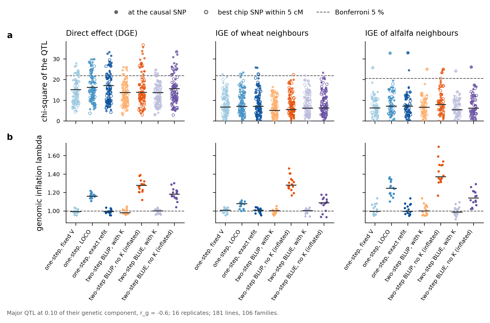
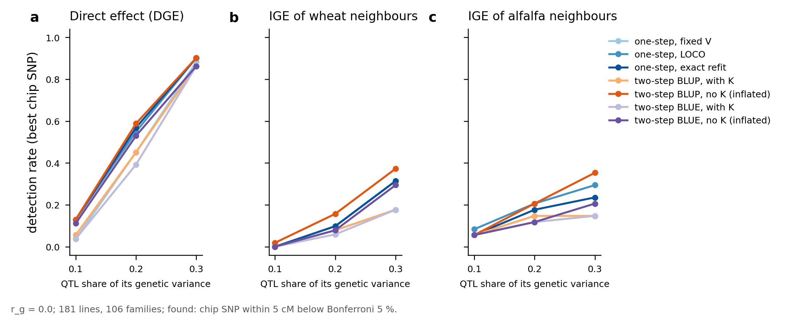
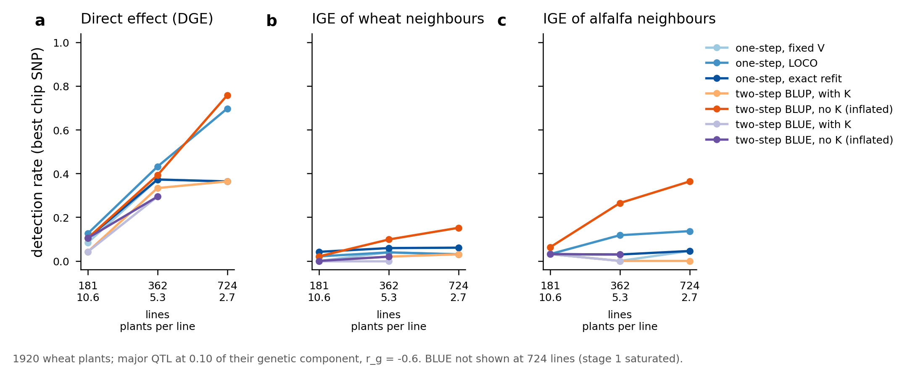
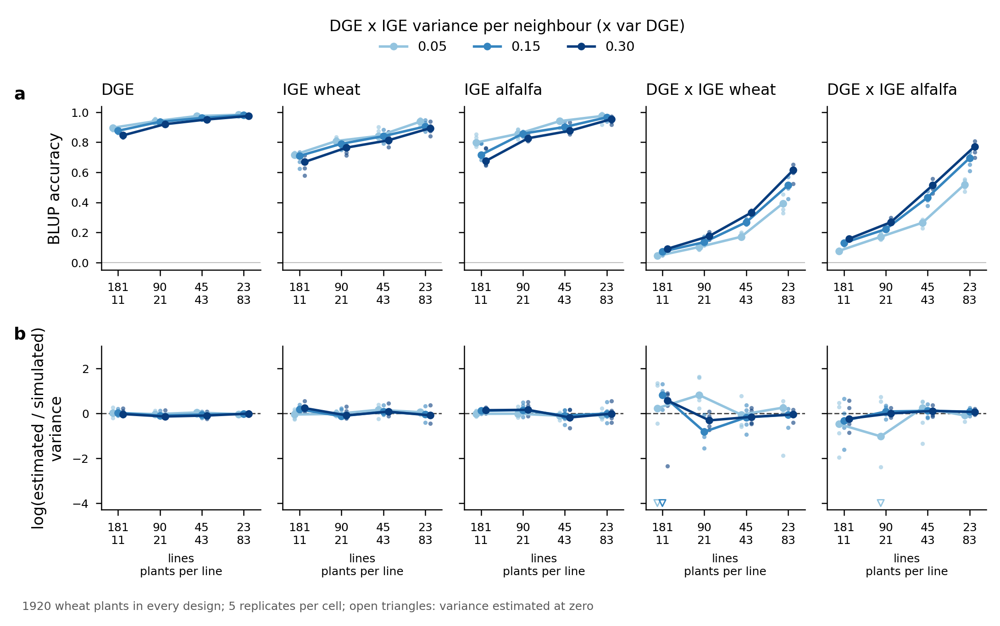
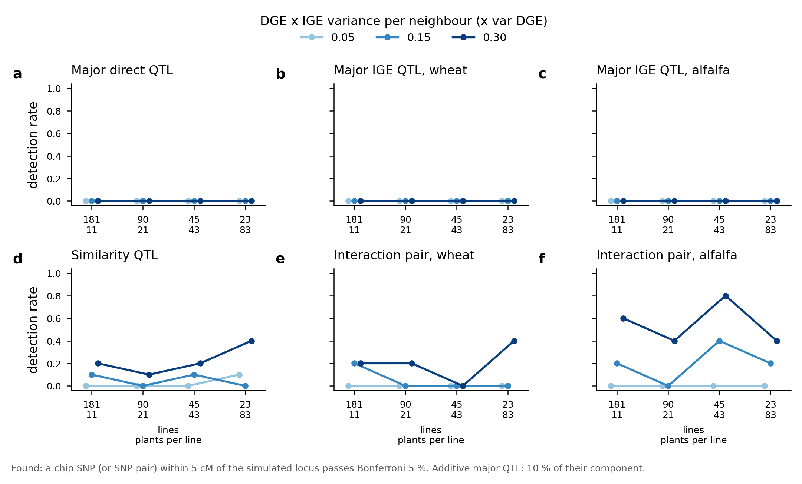
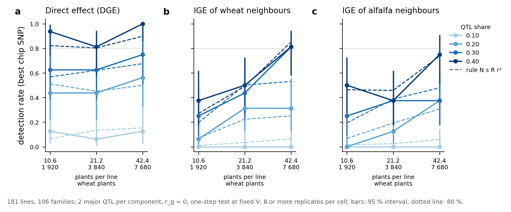

# Détection des QTL additifs de DGE et d'IGE : une étape contre deux étapes

Rapport du 2 novembre 2026. Simulations de `simulation/cogwas/` (cadre somme, scénario S2, paramètres de Salas et al. 2026). Figures et tableaux dans `docs/figures_qtl_additifs/`.

## Réponse courte

Le GWAS en deux étapes sur les BLUP ne détecte pas mieux les QTL additifs. Avec la parenté en seconde étape, il détecte un peu moins que le GWAS en une étape. Sans la parenté, il semble détecter davantage, mais son λ vaut 1,1 à 2,7 et ses faux pics sont 10 à 100 fois plus nombreux. Après correction par contrôle génomique, il ne garde aucun avantage.

La faible détection vient de la taille des effets simulés. Un QTL majeur porte 10 % de la variance de sa composante génétique. Pour la DGE, cela fait 2 % de la variance phénotypique d'une plante. Le χ² attendu au SNP causal vaut alors 14 en moyenne, contre un seuil de Bonferroni de 22. Pour l'IGE, le χ² attendu au SNP causal ne dépasse pas 7. Le dispositif fournit en effet deux fois moins d'information sur l'effet indirect d'une lignée que sur son effet direct.

Avec 181 lignées, une détection sûre (au moins 80 % des QTL trouvés par la puce) demande un QTL de DGE à 40 % de la variance génétique, quel que soit le nombre de répétitions. Pour l'IGE, elle demande un QTL à 30 ou 40 % et environ 42 plantes de blé par lignée, soit 7 680 plantes. La section sur les répétitions détaille la grille.

## Ce qui a été simulé

Le script `diag_qtl_power.R` reprend la simulation et le modèle nul de `run_cascade.R` :
- 181 lignées de blé et 106 familles de luzerne, 1 920 plantes de blé ;
- variance DGE 1, IGE blé 0,1 et IGE luzerne 0,1 par voisin, r_g = −0,6, H² individuel 0,30 ;
- interaction DGE × IGE de variance 0,05 par voisin ;
- 3 QTL majeurs de DGE, 3 d'IGE blé et 2 d'IGE luzerne, chacun à 10 % de sa composante ;
- puce de 17 770 SNP blé et 8 630 SNP luzerne après filtre MAF, sans les sites causaux ;
- modèle nul avec interaction, ajusté par remlax.

Le tableau suivant liste les méthodes appliquées à chaque QTL.

| Code | Méthode |
|---|---|
| p3d | une étape, variances du nul fixées (rx_scan, méthode actuelle) |
| loco | une étape, un nul par chromosome, parenté calculée sans ce chromosome |
| exact | une étape, réajustement complet pour les 10 meilleurs SNP de p3d |
| blup_k | BLUP du nul, puis modèle mixte au niveau lignée avec la parenté |
| blup_ols | BLUP du nul, puis régression simple sans parenté |
| blue_k | BLUE (effets génétiques fixes, spatial et interaction aléatoires), puis modèle mixte avec la parenté |
| blue_ols | BLUE, puis régression simple sans parenté |

Un QTL est trouvé quand un SNP de la puce à moins de 5 cM passe le seuil de Bonferroni à 5 %. Pour 17 770 SNP, ce seuil vaut p = 2,8 × 10⁻⁶, soit −log10(p) = 5,55. Le rapport donne les tests sur l'échelle du χ² à 1 degré de liberté, où ce seuil correspond à χ² = 21,9. Pour la luzerne (8 630 SNP), le seuil vaut −log10(p) = 5,24, soit χ² = 20,6. La correspondance entre les deux échelles figure dans le tableau suivant.

| χ²₁ | −log10(p) |
|---|---|
| 7 | 2,1 |
| 15 | 4,0 |
| 18 | 4,7 |
| 22 | 5,55 |
| 30 | 7,4 | Chaque méthode teste aussi le SNP causal lui-même. Cette seconde mesure sépare le manque de puissance au QTL de la perte par déséquilibre de liaison.

Sur genotoul, la série de taille d'effet garde 181 lignées et fait varier la part de chaque QTL majeur (0,10, 0,20 et 0,30). Comme r_g = −0,6 devient inatteignable au-delà de 0,10, ces cellules utilisent r_g = 0. La cellule 0,10 existe aux deux valeurs de r_g. Une autre série garde 1 920 plantes de blé et compare 181, 362 et 724 lignées.

| Cellule | Répétitions |
|---|---|
| 181 lignées, part 0,10, r_g −0,6 | 16 |
| 181 lignées, part 0,10, r_g 0 | 18 |
| 181 lignées, part 0,20, r_g 0 | 17 |
| 181 lignées, part 0,30, r_g 0 | 17 |
| 362 lignées, part 0,10, r_g −0,6 | 17 |
| 724 lignées, part 0,10, r_g −0,6 | 11 |

Tous les modèles nuls ont convergé.

## Résultats

### Dispositif réel, QTL à 10 % (181 lignées, r_g −0,6)

Taux de détection par le meilleur SNP de la puce :

| Cible | p3d | loco | exact | blup_k | blup_ols | blue_k | blue_ols |
|---|---|---|---|---|---|---|---|
| DGE | 0,08 | 0,12 | 0,10 | 0,04 | 0,10 | 0,04 | 0,10 |
| IGE blé | 0,00 | 0,02 | 0,04 | 0,00 | 0,02 | 0,00 | 0,00 |
| IGE luzerne | 0,03 | 0,03 | 0,03 | 0,03 | 0,06 | 0,03 | 0,03 |

χ² moyen au SNP causal (seuil 22 pour le blé, 20,6 pour la luzerne) :

| Cible | p3d | loco | exact | blup_k | blup_ols | blue_k | blue_ols |
|---|---|---|---|---|---|---|---|
| DGE | 15,4 | 17,4 | 17,5 | 13,9 | 16,4 | 13,7 | 16,1 |
| IGE blé | 7,8 | 8,3 | 8,5 | 6,0 | 7,1 | 7,6 | 8,1 |
| IGE luzerne | 7,3 | 8,8 | 8,4 | 7,1 | 8,9 | 6,6 | 7,6 |

λ médian, par répétition :

| Cible | p3d | loco | exact | blup_k | blup_ols | blue_k | blue_ols |
|---|---|---|---|---|---|---|---|
| DGE | 0,99 | 1,16 | 0,99 | 0,98 | 1,28 | 1,00 | 1,18 |
| IGE blé | 1,01 | 1,08 | 1,01 | 1,00 | 1,28 | 1,00 | 1,09 |
| IGE luzerne | 0,99 | 1,24 | 0,99 | 1,00 | 1,37 | 0,99 | 1,14 |

Faux pics cumulés sur 16 répétitions pour la DGE (SNP significatifs hors des fenêtres causales, comptés par segment de 5 Mb) : p3d 1, loco 5, exact 2, blup_k 0, blup_ols 10, blue_k 0, blue_ols 5.

Avec p3d, le SNP causal lui-même passe le seuil dans 21 % des cas pour la DGE. Le meilleur SNP de la puce ne le passe que dans 8 % des cas. Entre le causal et son meilleur marqueur, le déséquilibre de liaison vaut r² ≈ 0,7 en médiane, et le χ² baisse dans ce rapport.

### Taille d'effet

| Part du QTL | χ² causal DGE (p3d) | détection DGE (p3d / exact) | χ² causal IGE blé | détection IGE blé (p3d / exact) |
|---|---|---|---|---|
| 0,10 | 14,5 | 0,04 / 0,13 | 7,4 | 0,00 / 0,00 |
| 0,20 | 29,1 | 0,45 / 0,57 | 14,0 | 0,08 / 0,10 |
| 0,30 | 40,9 | 0,88 / 0,90 | 20,0 | 0,18 / 0,31 |

Le χ² au causal croît linéairement avec la part du QTL. Il vaut environ 135 fois la part pour la DGE et 65 fois la part pour l'IGE blé. Un QTL de DGE doit porter près de 20 % de la variance génétique pour être trouvé une fois sur deux. Pour l'IGE blé, un QTL à 30 % est trouvé une fois sur trois au mieux. La valeur de r_g ne change rien à la détection : à 0,10, les cellules r_g −0,6 et r_g 0 donnent les mêmes χ².

### Nombre de lignées à nombre de plantes fixé

| Lignées (plantes par lignée) | χ² causal DGE | détection DGE (p3d / loco) | χ² causal IGE blé | χ² causal IGE luzerne |
|---|---|---|---|---|
| 181 (10,6) | 15,4 | 0,08 / 0,12 | 7,8 | 7,3 |
| 362 (5,3) | 24,9 | 0,37 / 0,43 | 9,3 | 8,9 |
| 724 (2,7) | 32,7 | 0,36 / 0,70 | 8,7 | 11,0 |

Plus de lignées avec moins de répétitions augmente nettement la puissance sur la DGE. L'IGE n'en profite presque pas. Le balayage précédent (ci-dessous) allait dans l'autre sens : avec 23 lignées, aucun QTL additif n'est détecté, même si les BLUP de chaque lignée deviennent très précis.

## Pourquoi la puissance est si faible

Un test de SNP compare des génotypes entre eux. Son χ² attendu suit une règle simple :

χ² − 1 ≈ N × s × R

N est le nombre de génotypes (lignées ou familles) et s la part de la variance génétique portée par le QTL. R est la fiabilité de l'effet de chaque génotype mesuré sur ses propres plantes, sans l'aide de la parenté : R = σ²_g / (σ²_g + σ²_bruit / m). Ici m est le nombre d'observations par génotype et σ²_bruit ≈ 3,4, la variance phénotypique d'une plante hors de l'effet testé.

Pour la DGE, chaque lignée compte m ≈ 10,6 plantes. R vaut donc 1 / (1 + 3,4 / 10,6) = 0,76, et la règle prévoit 181 × 0,10 × 0,76 ≈ 14. La simulation donne 14,4.

Pour l'IGE blé, chaque lignée est voisine d'environ 21 plantes de blé, avec une variance de 0,1 par voisin. R vaut 0,1 / (0,1 + 3,4 / 21) = 0,38, et la règle prévoit 181 × 0,10 × 0,38 ≈ 6,9. La simulation donne 6,8.

Cette règle reproduit aussi la série du nombre de lignées :

| Lignées | DGE prévu / simulé | IGE blé prévu / simulé |
|---|---|---|
| 181 | 14 / 14 | 6,9 / 6,8 |
| 362 | 22 / 24 | 8,6 / 8,3 |
| 724 | 32 / 32 | 9,8 / 7,7 |

Pour l'IGE, elle implique un plafond. Le produit N × m est le nombre total de contacts blé-blé, environ 3 840 pour 1 920 plantes. Quand N grandit, N × R tend vers 3 840 × 0,1 / 3,4 ≈ 113, et le χ² d'un QTL d'IGE à 10 % plafonne vers 11. Aucun découpage des 1 920 plantes en lignées n'atteint le seuil de 22. Il faudrait environ deux fois plus de plantes de blé, ou des QTL deux fois plus gros. Pour la DGE, le plafond vaut 1 920 × 0,10 × 1 / 3,4 ≈ 56. Le dispositif réel, avec 181 lignées, en atteint le quart.

La parenté améliore la précision des BLUP sans augmenter ce χ². Un BLUP mélange l'information propre de la lignée et la prédiction par ses apparentées. Le test d'un SNP n'utilise que la première. Cela explique le résultat du balayage précédent : à 23 lignées, la précision des BLUP DGE monte à 0,98 et la détection tombe à zéro.

## Pourquoi les deux étapes ne font pas mieux

Le BLUP d'une lignée est un produit de la parenté : û = σ²_g K Z' V⁻¹ (y − Xβ). Avec la même parenté, le modèle de seconde étape explique donc toute la variance des BLUP. L'héritabilité de seconde étape vaut 1,00 dans toutes les répétitions, avec une variance résiduelle nulle. Le test reste calibré (λ ≈ 1) mais perd un peu de puissance. La DGE passe ainsi de 15,4 à 13,9 au causal, et l'IGE blé de 7,8 à 6,0. Il s'agit du double rétrécissement connu de cette approche.

La régression des BLUP sans parenté semble meilleure. Ses tests sont gonflés, avec un λ de 1,14 à 2,74 et de 10 à 220 faux pics selon les cellules. Le gonflement vient du fond polygénique, que le BLUP contient et que la régression attribue aux SNP en déséquilibre de liaison. Après contrôle génomique, la détection retombe au niveau de p3d ou en dessous (DGE à 0,10 : 0,06 contre 0,06 ; à 0,20 : 0,41 contre 0,45).

Les BLUE retirent le rétrécissement mais perdent de la précision. La précision des BLUE DGE vaut 0,88 à 181 lignées, 0,74 à 362 et 0,14 à 724. Pour l'IGE blé, elle vaut 0,60, 0,41 et 0,08. À 724 lignées, la première étape compte 1 872 effets fixes pour 1 920 plantes, et les BLUE ne contiennent presque plus de signal. Avec la parenté, la seconde étape sur BLUE reste calibrée et rejoint p3d à 181 lignées. Elle décroche dès 362 lignées.

L'analyse en une étape reste donc la référence. Elle utilise tous les contacts de chaque plante en un seul modèle, avec la covariance exacte entre DGE et IGE.

## Gains possibles dans l'analyse en une étape

Le réajustement exact des meilleurs SNP augmente le χ² au causal d'environ 2 unités pour la DGE à 10 %, et de 7 à 13 unités pour les gros QTL. La calibration ne bouge pas. Pour la DGE à 0,20, la détection passe de 0,45 à 0,57. Celle de l'IGE blé à 0,30 passe de 0,18 à 0,31. Ce réajustement coûte 4 min par répétition sur GPU et peut devenir la procédure par défaut de la cascade.

Le LOCO apporte un gain voisin, mais son λ vaut 1,1 à 1,4. Ses faux pics sont aussi plus nombreux, 5 contre 1 pour la DGE à 10 % et 30 contre 2 à 724 lignées. Avec 1 500 sites causaux répartis sur tout le génome, le λ du LOCO reflète en partie un vrai signal polygénique. La simulation ne permet pas de séparer cette part d'un défaut de calibration. Son coût est aussi élevé : 15 min par répétition sur A100, contre 13 s pour le nul seul.

## Rappel du balayage dispositif × variance d'interaction

Le balayage terminé dans la nuit garde 1 920 plantes de blé et fait varier le nombre de lignées (181, 90, 45, 23) et la variance d'interaction par voisin (0,05, 0,15, 0,30), avec 5 répétitions par cellule.

La précision des BLUP monte quand le nombre de lignées baisse. Elle passe de 0,88 à 0,98 pour la DGE, de 0,05 à 0,4–0,6 pour l'interaction blé et de 0,08 à 0,5–0,8 pour l'interaction luzerne. Seules les cellules à 45 lignées et moins estiment bien les variances d'interaction. Aucune cellule ne détecte de QTL majeur additif, conformément à la règle ci-dessus. Les paires d'interaction luzerne sont trouvées dans 40 à 80 % des cas à la variance 0,30.

## Nombre de répétitions à 181 lignées

La grille garde 181 lignées et 106 familles de luzerne. Elle multiplie le nombre de bacs par 2 puis par 4, de 12 à 48, soit 10,6, 21 et 42 plantes de blé par lignée. Chaque composante porte 2 QTL majeurs, avec r_g = 0 et une part de 0,10 à 0,40. Chaque cellule compte 8 répétitions, soit 16 QTL. Le modèle nul est additif, sans les noyaux d'interaction, et le test est fait à V fixé (p3d). Ce modèle nul reste calibré : λ vaut 0,93 à 1,03 dans toutes les cellules.

Le tableau donne la détection par le meilleur SNP de la puce à moins de 5 cM, puis entre parenthèses la détection au SNP causal.

| Cible | Part | 10,6 plantes/lignée | 21 plantes/lignée | 42 plantes/lignée |
|---|---|---|---|---|
| DGE | 0,10 | 0,12 (0,31) | 0,06 (0,12) | 0,12 (0,25) |
| DGE | 0,20 | 0,44 (0,81) | 0,44 (0,88) | 0,56 (1,00) |
| DGE | 0,30 | 0,62 (1,00) | 0,62 (1,00) | 0,75 (1,00) |
| DGE | 0,40 | 0,94 (1,00) | 0,81 (1,00) | 1,00 (1,00) |
| IGE blé | 0,20 | 0,06 (0,19) | 0,31 (0,38) | 0,31 (0,69) |
| IGE blé | 0,30 | 0,25 (0,38) | 0,44 (0,69) | 0,81 (1,00) |
| IGE blé | 0,40 | 0,38 (0,88) | 0,50 (1,00) | 0,81 (1,00) |
| IGE luzerne | 0,20 | 0,00 (0,06) | 0,12 (0,19) | 0,38 (0,44) |
| IGE luzerne | 0,30 | 0,25 (0,44) | 0,38 (0,69) | 0,38 (0,75) |
| IGE luzerne | 0,40 | 0,50 (0,75) | 0,38 (0,88) | 0,75 (1,00) |

Aucun QTL à 0,10 n'est détecté de façon fiable, quelle que soit la cible. L'intervalle à 95 % d'un taux mesuré sur 16 QTL a une demi-largeur d'environ 0,25.

Pour la DGE, les répétitions changent peu la détection. La fiabilité propre d'une lignée vaut déjà 0,76 à 10,6 plantes et ne monte qu'à 0,93 à 42 plantes. Le SNP causal passe le seuil dès une part de 0,30, et dès 0,20 à 42 plantes. La puce perd une partie de ces QTL, car le r² médian entre le QTL et son meilleur marqueur vaut 0,55 à 0,85. Le seuil de 80 % par la puce n'est atteint qu'à 0,40.

Pour l'IGE blé, les répétitions sont le levier principal. La fiabilité de l'effet indirect d'une lignée passe de 0,38 à 0,55 puis à 0,71. À une part de 0,30, la détection par la puce passe de 0,25 à 0,44 puis à 0,81. Le plafond de 3 840 contacts décrit plus haut vaut à nombre de plantes fixé. La grille augmente justement ce nombre de plantes.

Pour l'IGE luzerne, la tendance est la même, avec plus de bruit. Seule la part de 0,40 à 42 plantes par lignée approche 80 % par la puce. Au SNP causal, cette cellule atteint 100 %.

La règle χ² − 1 ≈ N s R r² suit les 36 cellules (tirets de la figure). Une détection à 80 % au seuil de Bonferroni demande un χ² non central de paramètre 30,5. Avec 181 génotypes, il faut donc s × R × r² ≥ 0,17. Pour un r² de 0,7, cela donne s × R ≥ 0,24, soit une part de 0,26 à 0,32 pour la DGE et de 0,34 pour l'IGE blé à 42 plantes par lignée. La variabilité du r² entre QTL décale encore ces seuils vers le haut.

Les faux pics restent rares, sauf autour des gros QTL de DGE : 13 et 15 sur 8 répétitions à 0,40 avec 21 et 42 plantes par lignée. Ce sont probablement des marqueurs liés au QTL au-delà de la fenêtre de 5 cM.

Au-delà de ces combinaisons, la densité de la puce limite la détection plus que le phénotypage. Au SNP causal, un QTL de DGE à 0,30 est toujours trouvé. Pour l'IGE, il faut 0,30 à 0,40 avec 42 plantes par lignée.

## Limites et incidents

- La part des QTL luzerne était calculée par `diag_qtl_power.R` avec la dose familiale (0 à 2) au lieu de la dose plante (0 à 4). La correction (facteur 4) est appliquée dans `fig_qtl_diag.py`. Après correction, la part médiane vaut 0,08 à 0,10 comme prévu.
- 5 tirages ont échoué parce que r_g = −0,6 n'était pas atteignable avec les effets polygéniques tirés. Les tirages retenus restent donc légèrement sélectionnés.
- Plusieurs lancements ont dépassé la limite de 6 h sur les nœuds CPU partagés de genotoul, dont les temps varient d'un facteur 10 à 40. Une dizaine de lancements tournent encore. Les résultats ci-dessus portent sur 96 répétitions terminées.
- La règle χ² − 1 ≈ N s R néglige le déséquilibre de liaison entre le QTL et le fond polygénique et l'apport de la parenté. Elle surestime un peu l'IGE à 724 lignées.
- Les seuils de Bonferroni sont stricts pour une puce dense en déséquilibre de liaison. Avec environ 3 000 tests effectifs, le seuil passerait de 22 à 19 unités de χ². Les ordres de grandeur ne changeraient pas.

## Fichiers

- `simulation/cogwas/diag_qtl_power.R` : simulation, modèle nul et les sept méthodes de test, pour une répétition.
- `simulation/cogwas/fig_qtl_diag.py` : tableaux `qtl_summary.csv` et `qtl_calibration.csv`, figures `fig_qtl_chi2`, `fig_qtl_power` et `fig_qtl_lines`.
- `simulation/cogwas/fig_qtl_grid.py` : grille des répétitions, tableau `qtl_grid_summary.csv` et figure `fig_qtl_grid`. Lancée par `diag_qtl_power.R --bins 12|24|48 --n_major 2 --null additive` (jobs 45159073 en CPU et 45159074 en GPU, sorties dans `/work/user/nsalas/simcog/qtl_grid2/`).
- Lanceurs genotoul : `/work/user/nsalas/simcog/simqtl.sbatch` (série de taille d'effet, job 45158334) et `simqtl_lines.sbatch` (série du nombre de lignées, job 45158375). Sorties brutes dans `/work/user/nsalas/simcog/qtl_diag/`.

## Suites possibles

- Passer le réajustement exact par défaut dans la cascade (`run_cascade.R --exact yes` le fait déjà pour le modèle à interaction).
- Simuler des QTL majeurs plus gros, à 20 ou 30 %, pour la cascade complète. La question d'un QTL pléiotrope (DGE et IGE au même locus) reste ouverte. Elle permettrait de garder r_g = −0,6 avec de gros QTL.
- Pour l'IGE, la règle montre que seul un dispositif plus grand ou des effets plus gros rendent un QTL détectable. Le co-GWAS au niveau allélique et le test conjoint dir+ind sont les leviers restants dans l'analyse.
